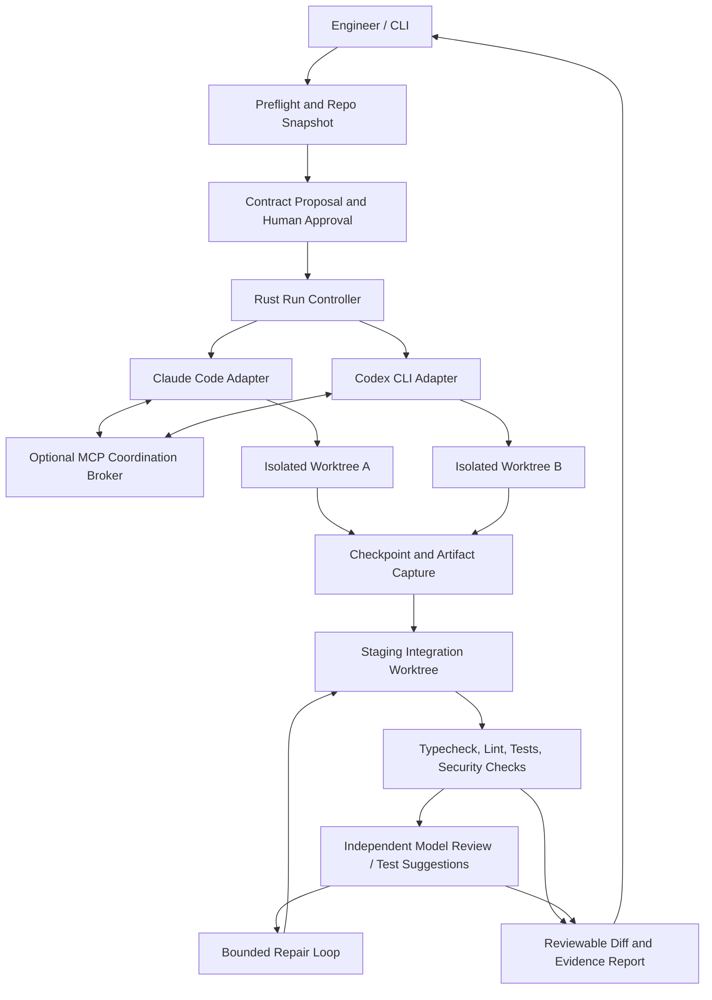

# Architecture & PRD: Contract-First Cross-Model Agent Orchestrator (Claude + Codex)

# Synapse-Mux — Contract-First Cross-Model Agent Orchestrator

**PRD and technical architecture · Revision 3 · 29 October 2026 · open-source release plan**

<aside>
🎯

**Product thesis:** For high-risk, cross-module coding tasks, two heterogeneous coding agents can produce a more reliable integrated change when they implement against an approved contract, work in isolated Git worktrees, and pass deterministic checks plus independent verification. Synapse-Mux must prove this improves integration outcomes enough to justify extra model usage and orchestration overhead.

</aside>

## 0. Executive decision

Build a **local-first CLI prototype**, not the entire production daemon in the first milestone. Use **Rust + Tokio** for the orchestration core (decision resolved, §15 item 8) and Claude Code + Codex CLI as the initial worker adapters. Defer the three-pane TUI, live speculative merging, automatic mid-run contract mutation, multi-language AST enforcement, and remote execution until the core workflow is validated.

**Primary differentiator:** measurable improvement in contract compliance and integrated-test success—not the ability to launch multiple agents.

**Status of claims:** Product outcomes, performance numbers, and cost improvements in this document are hypotheses or proposed targets until tested. Do not present them as measured results.

### 0.1 Open-source decision (added in Revision 3)

Synapse-Mux will be developed and released as open-source software. This changes the success criteria and several requirements. It does not change the product thesis or the evaluation gates in §10.

- **Success metric:** evidence-backed adoption: reproducible public evaluation results, external users completing runs on their own repositories, and external contributors landing adapters or fixes. Repository stars and download counts are not success metrics.
- **Revenue:** none planned for the MVP. Do not add features whose only purpose is monetization. Sustainability options are deferred to §15 item 7.
- **License:** select before the first public commit (§15 item 9). Relicensing after outside contributions generally requires every contributor's consent unless a CLA grants it, so adopt DCO sign-off from the first external contribution.
- **Provider terms:** before release, verify that the Claude Code and Codex CLI terms and account modes permit third-party orchestration of those CLIs (§15 item 10). Publish the supported authentication modes. Never bundle vendor binaries or credentials.
- **Extension point:** provider adapters are the primary contribution surface. Define a stable adapter interface, a conformance test suite, and recorded-event fixtures so contributors can add a provider without touching the state machine.
- **Maintenance cost:** vendor CLI flag and event-schema churn is the dominant ongoing cost (§14). Publish a tested version matrix, run CI on recorded fixtures, and run a scheduled canary against the latest CLI releases.
- **Public evaluation:** the harness, task definitions, pre-registration file, raw per-run results, model and CLI versions, and cost data are published in the repository, including negative results (§10).
- **User privacy and security:** see the open-source obligations in §7.

## 1. Problem, customer, and value proposition

### 1.1 Problem statement

When two coding agents implement different parts of the same feature in separate worktrees, each can make locally reasonable but incompatible assumptions about interface names, data shapes, error behavior, transaction semantics, retries, or ownership. Git worktrees prevent direct working-file overwrites; they do not ensure semantic compatibility or a correct combined result.

The associated problems are:

1. **Interface drift:** independently implemented components disagree on shared API, type, persistence, or error contracts.
2. **Correlated verification blind spots:** an implementation and its author-generated tests may share assumptions. A second model may identify additional cases, but its review is not a correctness oracle.
3. **Expensive late integration:** conflicts, dependency changes, generated-file mismatches, and failing integration tests appear after separate implementations are complete.
4. **Context and recovery overhead:** raw logs contain tool noise; unstructured handoffs can lose essential decisions. Interrupted runs need a reliable checkpoint and recovery path.
5. **Poor observability:** users need to know what each agent changed, which checks ran, what remains uncertain, how much time was spent, and what cost data is actually observable.

These are the product hypotheses to test. Do not claim that all existing orchestration tools fail at these jobs. Several competing tools already provide multi-agent sessions and isolated workspaces. The opportunity is a stricter, testable integration workflow.

**External evidence and its limits (verify before citing in the README):**

- CAID ([https://arxiv.org/html/2603.21489v1](https://arxiv.org/html/2603.21489v1)) reports that parallel agents frequently fail to integrate even when each produces good isolated output, because they hold inconsistent views of shared state.
- AgentRoom ([https://www.alphaxiv.org/abs/2608.23740](https://www.alphaxiv.org/abs/2608.23740), preprint) reports uncoordinated parallel-merge scoring below a single agent (0.456 vs 0.544, LLM-judge scores). Parallelism without coordination can be net-negative, so the single agent is the honest baseline.
- CodeCRDT ([https://arxiv.org/html/2510.18893v1](https://arxiv.org/html/2510.18893v1)) reports zero character-level conflicts but roughly 5–10% semantic conflicts on preliminary inspection.
- CooperBench results appear in a vendor blog post; discount them and read the primary benchmark before citing.
- Market size is unmeasured. The paying user decomposes one coupled feature across agents; most parallel-agent use is on independent tasks, where conflicts are rare. Do not put a market-size number in this PRD until user interviews support one.

### 1.2 Target user and initial ICP

- **Primary user:** senior/staff software engineer or tech lead working in a substantial repository.
- **Initial repository scope:** Git repositories using TypeScript, with a defined typecheck and test command. Expand language support only after the contract and integration workflow is reliable.
- **Initial worker providers:** Claude Code and OpenAI Codex CLI.
- **Best-fit tasks:** changes spanning at least two modules or layers, where an agreed interface and a reliable integration test can be stated before implementation.
- **Poor-fit tasks:** trivial fixes, exploratory changes without a testable contract, tasks whose subtasks cannot be cleanly partitioned, or repositories whose build/test commands are unreliable.

### 1.3 Job to be done

“Given a complex feature, help me agree on the interface before implementation, have two agents make bounded changes without silently interfering with one another, prove that the combined change passes the repository's checks, and give me a reviewable diff with traceable evidence.”

### 1.4 Value proposition

Synapse-Mux should reduce the time an engineer spends reconciling incompatible agent output and increase the rate of successful integration. It does not promise bug-free code, fully autonomous delivery, or zero conflicts.

## 2. Competitive context and positioning

Multi-agent workspaces, CLI execution, Git worktrees, and agent handoffs are increasingly available in existing tools. Paradev, for example, documents isolated workspaces, agent orchestration, and same-task agent racing. The larger competitive pressure is first-party and adjacent: Claude Code Agent Teams (experimental, shipped February 2026) runs a lead session with teammate sessions in separate worktrees; Codex, Windsurf, Cline, Devin and others added parallel-agent features in the same period; GitHub Copilot hosts both Claude and Codex agents; and integration-layer projects (for example Weave, Clash, and GitButler's agent features) target semantic merging and conflict avoidance. Verify each claim against current documentation before publishing. Native CLI functionality also changes over time. These facts make generic “run Claude and Codex in parallel” positioning weak.

**Positioning statement:** Synapse-Mux is an integration-quality control plane for heterogeneous coding agents. It establishes a reviewed contract, enforces task ownership as far as the configured isolation permits, integrates concrete checkpoints, and produces deterministic verification evidence plus independent model review.

Differentiation must be demonstrated with an evaluation against:

- **Baseline A:** one coding agent completes the task alone.
- **Baseline B:** two agents use ordinary isolated worktrees with the same written specification, the same CI gate, and a reviewer pass. B must be strong so the comparison isolates the contract, ownership, and verification contribution rather than the presence of CI.
- **Candidate C:** Synapse-Mux contract-first orchestration and verification with heterogeneous workers (Claude + Codex).
- **Ablation C-same:** the identical workflow with two workers from the same provider. Without this arm, the "cross-model" claim is untested.
- **Baseline D:** one agent given the approved contract and contract tests, working sequentially.

References:

- [Paradev orchestration](https://docs.paradev.com/orchestration)
- [Paradev overview](https://docs.paradev.com/overview)
- [Claude Code CLI reference](https://code.claude.com/docs/en/cli-usage)
- [Codex CLI reference](https://learn.chatgpt.com/docs/cli/reference)

## 3. Product goals and non-goals

### 3.1 Goals for the MVP

1. Start Claude Code and Codex CLI as supervised, non-interactive subprocesses with structured output where supported.
2. Create independent worktrees from a recorded base commit.
3. Generate or import a contract and partition manifest, validate its structure, and require explicit human approval before parallel implementation.
4. Detect out-of-partition modifications and contract changes before integration; communicate violations clearly.
5. Integrate worker changes at explicit checkpoints into a staging worktree.
6. Run configured deterministic checks before using model-generated reviews as additional signals.
7. Run a bounded repair loop and stop when the budget, turn, retry, or time limit is reached.
8. Persist enough run state, diffs, diagnostics, and check results to inspect and recover a run.
9. Present a final unified diff and evidence report. **Never merge into the user's base branch without explicit user action.**

### 3.2 Non-goals for the MVP

- Unlimited agent count or general distributed scheduling.
- A hosted service, remote worker fleet, team billing, or centralized source-code storage.
- Guaranteed prevention of every malicious or out-of-scope process write; security guarantees depend on OS sandboxing and configuration.
- A universal AST-based contract checker for every programming language.
- Live, per-file-save speculative merges.
- Automatic contract changes while workers continue using an older contract.
- Autonomous merge to `main`, push, release, or deployment.
- A full-screen TUI before the CLI workflow is stable.
- An exact billed-USD figure when the active provider or subscription does not expose the necessary billing data.

## 4. Core workflow and state machine

The orchestrator maintains a durable state machine. Every state transition must be recorded with run ID, timestamp, input artifact IDs, outcome, and diagnostic summary.

1. **PREFLIGHT:** validate repository state, Git availability, CLI versions/authentication, configured commands, path allowlist, and budget settings. Require a clean starting tree by default; allow a deliberate override only with a clear safety prompt and a recorded base snapshot.
2. **CONTRACT_PROPOSAL:** analyze the feature prompt and repository; propose contract files, behavioral requirements, partition ownership, verification commands, and unresolved decisions.
3. **CONTRACT_APPROVAL:** validate the manifest, check paths and overlaps, run available contract/type checks, and obtain human approval. No implementation worker starts before approval.
4. **IMPLEMENTATION:** create one worktree per worker from the same approved base/contract revision; launch bounded tasks. Workers may only claim shared files through the broker if the files are not already claimed.
5. **CHECKPOINT:** capture each worker's committed and uncommitted changes, status, untracked files, and diagnostics into an immutable run artifact. Mark the checkpoint with the exact base commit and contract hash.
6. **INTEGRATION:** construct an integration worktree from explicit snapshots, resolve merge conflicts only through a controlled step, and never overwrite the user's original working tree.
7. **VERIFICATION:** run deterministic checks first, then independent review/test generation where configured. Keep model findings separate from executed test results.
8. **REPAIR:** route the smallest relevant contract, diff, failing test, and diagnostic bundle to the responsible worker. Stop after the configured global repair limit or budget is reached.
9. **REVIEW_READY:** present the integrated diff, changed paths, check results, remaining findings, run log, and usage/cost estimates. User approval is required for delivery or merge.
10. **FAILED / CANCELLED / NEEDS_USER:** terminal states are explicit and recoverable. No failure path may silently report success.

### 4.1 State transition rules

- A contract change invalidates affected worker acknowledgements. Pause affected workers, revise the contract version, re-run validation, and require re-acknowledgement or restart. The MVP does not hot-swap contracts into a running context.
- A worker is not “complete” solely because it emitted a completion message. The supervisor must capture its exit code and workspace state.
- A timeout, process crash, malformed event stream, or exhausted budget must result in a recorded failure state and retained evidence.
- Retries must be idempotent where possible. The supervisor must not duplicate a merge, commit, or user-visible side effect after restart.

## 5. Proposed architecture

### 5.1 Components

| Component | Responsibility | MVP implementation |
| --- | --- | --- |
| CLI / TUI | Start, inspect, cancel, resume, review diff | CLI first; TUI later |
| Run controller | State machine, budgets, timeouts, retry policy, persistence | Rust + Tokio |
| Provider adapters | Spawn CLI, parse events, normalize statuses and usage | Separate Claude and Codex adapters |
| Workspace manager | Create worktrees, capture snapshots, clean up safely | Git CLI initially; benchmark before adopting lower-level Git APIs |
| Contract/partition validator | Validate manifest, path ownership, contract version and hash | Deterministic Rust logic |
| MCP broker | Expose a small set of coordination tools to workers | Add after basic subprocess flow works |
| Integration runner | Assemble checkpoints and run deterministic checks | Separate staging worktree |
| Context packer | Build bounded, relevant repair/review bundles | Structured artifacts; never raw transcript piping by default |
| Run store | Persist state and artifact metadata for resume/inspection | SQLite or a versioned local JSON format; decide after prototype |

### 5.2 Architecture diagram



### 5.3 Data flow and source of truth

- Git remains the source of truth for repository content and diffs.
- The run controller is the source of truth for lifecycle state and policy decisions.
- Each worker has an independent worktree and a bounded task.
- Shared artifacts are versioned: approved contract, partition manifest, worker checkpoint, integration snapshot, test results, and final report.
- Every checkpoint records the base commit, contract digest, changed paths, untracked paths, and a stable artifact identifier.
- Provider event streams are parsed into a versioned internal `AgentEvent` enum. Preserve raw logs as local diagnostic artifacts subject to retention rules, but do not send raw logs to another model by default.

## 6. Functional requirements

### FR-1 — CLI lifecycle and structured subprocess management

- Launch workers without scraping ANSI terminal screens for status.
- Parse structured events where the CLI provides them; isolate parser implementations by provider and version.
- Distinguish stdout, stderr, process exit code, usage events, final result, timeout, and cancellation.
- Use argument arrays rather than interpolating untrusted prompt strings into a shell command.
- Support configurable maximum duration, turns where available, output size, repair attempts, and concurrency.
- Pin and test supported CLI version ranges. At startup, capture CLI version and capabilities; fail clearly when a required capability is absent.
- Treat a JSONL schema change or malformed event as a compatibility error, not a successful result.

**Current command references:** Claude Code documents print mode `-p`, `--output-format stream-json`, `--verbose`, `--max-turns`, `--max-budget-usd`, and `--mcp-config`; some flags have minimum-version requirements. Codex documents `codex exec`, `--json` JSONL events, sandbox/approval options, and optional worktree support. The implementation must validate exact flags against the installed CLI version and supported account mode. Do not assume feature parity or identical cost semantics across providers.

- [Claude Code CLI reference](https://code.claude.com/docs/en/cli-usage)
- [Codex CLI reference](https://learn.chatgpt.com/docs/cli/reference)
- [Codex non-interactive mode](https://learn.chatgpt.com/docs/non-interactive-mode)

### FR-2 — Contract and partition manifest

The approved `synapse-spec.json` must validate against a versioned schema and include:

- `schema_version`, `run_id`, `feature_id`, `base_commit`, and a unique contract revision/hash.
- `contract_files`: paths and intended interface semantics. Every interface that crosses a partition boundary must be listed, including repository and persistence interfaces.
- `contract_tests`: executable tests of cross-partition behavior (error handling, retry and idempotency semantics, transaction boundaries, and at least one integration test through the real seam). Authored and approved before implementation starts, hash-locked, and read-only to workers.
- `partitions`: worker role, owned paths/globs, explicit read/write permissions, and task acceptance criteria.
- `shared_files`: files requiring an exclusive claim or human decision. Each shared file has exactly one owner (a worker or the supervisor); non-owners request changes through the supervisor. Lockfiles are never textually merged: regenerate them with the package manager after integration.
- `verification_commands`: argv, working directory, timeout, expected exit-code handling, and whether the command is required.
- `budgets`: max worker turns when supported, wall-clock deadlines, repair count, output/context limits, and cost/usage thresholds.
- `risk_flags`: destructive commands, schema migrations, generated files, dependency manifests, network access, or other operations requiring human approval.

Validation rules:

- Canonicalize paths and reject paths escaping the repository root.
- Reject overlapping write ownership unless an explicit shared-file policy exists.
- Reject unknown fields or unsupported schema versions unless forward-compatibility is deliberately specified.
- Hash approved contract content and include the hash in every checkpoint and worker prompt.
- Record ambiguous requirements as open questions; do not silently invent missing API behavior.

The contract is a reviewed interface plus executable contract tests, and an acceptance artifact. Type checking alone proves structural compatibility only; it cannot verify retry, transaction, or error semantics, so a contract without contract tests is not sufficient for this product's stated failure class. Not all behavior can be checked statically.

### FR-3 — Ownership and contract enforcement

- Treat `chmod 0444`, Git hooks, and filesystem watchers as guardrails and detection mechanisms, **not security boundaries**.
- At each checkpoint, compare modified, deleted, renamed, and untracked paths against the approved ownership manifest. Report violations before integration.
- Protect the original user working tree: run workers in generated worktrees; reject paths that resolve outside allowed roots; do not follow unsafe symlinks outside configured boundaries.
- If the worker process runs with general shell access, disclose that path checks after-the-fact cannot guarantee prevention of all writes. Where the configured OS supports it, allow a sandbox policy to restrict filesystem and network access.
- If a contract file changes, invalidate the approved contract digest and stop integration until the change is explicitly reviewed and approved.
- Save rejected out-of-partition changes in a recoverable artifact before attempting cleanup.

### FR-4 — MCP coordination broker

MCP is optional in the first runnable vertical slice. When enabled, expose narrowly scoped and deterministic tools:

| Tool | Inputs | Behavior |
| --- | --- | --- |
| `claim_shared_file` | path, reason, task ID | Atomically grant an exclusive claim only for an allowlisted shared file; otherwise return a structured denial. |
| `query_peer_state` | symbol or path | Return a bounded summary of the peer checkpoint, relevant signature, and diff excerpt; never return raw conversation history. |
| `verify_contract_compliance` | checkpoint ID | Run configured deterministic checks and return structured diagnostics with a stable result ID. |
| `submit_partition_complete` | summary, checkpoint ID | Request completion; supervisor independently validates exit status, changed paths, untracked files, contract hash, and required checks. |
| `propose_contract_amendment` | rationale, patch proposal | Record a proposal and pause affected tasks; never auto-apply a contract change behind a running agent. Human approval is required in the MVP. |

All tools must validate inputs, constrain file paths and output size, have deterministic error codes, and log state-changing operations. Use a maintained MCP SDK and target a supported specification revision instead of hand-implementing protocol details. Official MCP release history: [Model Context Protocol releases](https://github.com/modelcontextprotocol/modelcontextprotocol/releases).

### FR-5 — Integration and conflict handling

- Do not run a merge check against branch refs and assume that it reflects uncommitted workspace changes.
- At each checkpoint, represent the actual worker result through a stable Git snapshot/commit or equivalent captured index/tree, including relevant file additions, deletions, renames, and untracked-file handling.
- Integrate explicit snapshots in an isolated staging worktree. Record both source revisions and the integration result.
- Run integration after each meaningful checkpoint or when an agent finishes, not after every file-save event in the MVP.
- On conflict, produce the conflicting paths and a bounded diff/context package. Never silently select a winner.
- Handle dependency manifests and generated files as high-risk shared artifacts; merge them deliberately and rerun install/generation checks where configured.
- Add live speculative merge detection only if measurements show it reduces recovery effort relative to checkpoint integration.

### FR-6 — Verification pipeline

Run checks in this order unless the project configuration specifies a justified alternative:

1. Manifest and contract validation.
2. Path ownership and contract-hash checks.
3. Formatting, linting, and static type checks.
4. Approved contract tests (hash-locked), then unit and integration tests required by the repository.
5. Security or migration checks configured for the project.
6. Independent model review and adversarial test suggestions.
7. Execute any newly generated tests in the staging worktree before counting them as evidence.

Classify results as **passed**, **failed**, **not run**, or **inconclusive**. Model review text is a finding, not a passed test. A successful build is necessary evidence but is not proof of semantic correctness.

### FR-7 — Context firewall and artifact packing

Repair and review prompts must be assembled from structured, bounded artifacts:

- approved contract and acceptance criteria;
- failing worker's focused diff;
- exact failed test or check and reproducible command;
- relevant diagnostic output with configurable line and byte limits;
- peer review finding if needed;
- stable contract/checkpoint identifiers.

Do not include unrelated conversations, full event streams, or passing logs by default. Keep a local audit trail of which artifacts were sent to each provider. Support a payload-size threshold, but make the threshold configurable and test it against the provider's input/transport constraints rather than encoding an unverified global limit.

### FR-8 — Budgets, cancellation, and cost reporting

- Enforce per-worker wall-clock timeouts, maximum repair attempts, maximum parallel workers, output-size limits, and provider-supported turn or spend caps.
- Use a global run budget as well as per-phase limits.
- Stop scheduling new work as soon as a configured threshold is reached; request graceful termination, then force-kill a worker after a timeout.
- Label telemetry accurately:
    - **Observed usage:** token/usage values exposed by the CLI event stream.
    - **Estimated cost:** locally calculated from a versioned pricing table or provider-returned estimate.
    - **Billed cost:** only where authoritative billing data is available.
- Never label an estimate as actual spend. CLI usage telemetry and account billing may not provide equivalent per-run cost data.
- Show the budget policy, usage source, timestamp, pricing-table version, and any missing data in the final report.

### FR-9 — Persistence, resume, and cleanup

- Persist state transitions, worker identifiers, process exit codes, checkpoints, diffs, diagnostics, and verification results.
- Support safe resume from a completed checkpoint. If the contract/base commit no longer matches, require restart or explicit reconciliation.
- On cancellation, terminate workers, preserve artifacts, and mark the run cancelled.
- Only delete generated worktrees after a completed run and explicit retention policy; never delete a pre-existing user worktree.
- Startup recovery must detect orphaned worker processes and stale locks and present a recovery choice rather than blindly deleting state.

## 7. Security and trust boundaries

Synapse-Mux supervises tools that can read, write, and execute code. Multiple worktrees are isolation of working directories, not a complete process sandbox.

Requirements:

- Never place provider tokens or secrets in prompts, saved event artifacts, manifests, or command-line arguments where avoidable.
- Inherit only required environment variables; redact likely secret values from logs.
- Make network access, destructive shell commands, package installation, deployment, and pushes explicit policy decisions.
- Do not run agent-proposed scripts outside an allowlisted worktree without approval.
- Canonicalize paths and validate symlinks; defend against path traversal and unsafe cleanup.
- Keep the default workflow local-first. Do not transmit source code to any service beyond the configured coding-agent providers and explicitly enabled tools.
- Show which files and logs will be sent during each agent call.
- Require explicit user approval for contract acceptance, destructive changes, final merge, push, and any operation outside the run's workspace.
- Threat-model prompt injection in repository files, test output, generated artifacts, and MCP tool results. Treat repository content as untrusted input rather than policy.
- Document which guarantees are preventive (sandbox/policy) and which are detective (diff inspection after execution).
- Open-source obligations: publish a [SECURITY.md](http://SECURITY.md) with a vulnerability-disclosure process; publish the threat model; ship no telemetry by default; provide a redacted diagnostic bundle for issue reports so users never need to attach raw run artifacts that may contain proprietary code.

## 8. Non-functional requirements and performance policy

Avoid hard latency targets until a reproducible benchmark environment is defined.

| Metric | MVP acceptance policy | Measurement method |
| --- | --- | --- |
| Worker event correctness | No lost terminal state in tested event fixtures; malformed events fail visibly | Adapter fixture tests and CLI integration tests |
| Run recovery | Resume from a durable checkpoint without duplicate merge or lost artifacts | Kill/restart fault-injection tests |
| Workspace safety | Original worktree remains unchanged by worker execution in integration tests | Git status/diff before and after test runs |
| Ownership enforcement | All deliberate out-of-partition edits are detected in test fixtures | Path-policy unit and integration tests |
| Budget controls | Timeouts, retry caps, and stop-scheduling behavior work at configured limits | Fault-injection tests |
| Resource use | Record idle and active RSS; set a hard target only after measuring a reference build | Benchmark on documented OS, hardware, repo, and worker count |
| Integration latency | Track checkpoint-to-integrated-result distribution; do not require per-save sub-15 ms checks in MVP | P50/P95 from representative repositories |
| Correctness outcomes | Compare success rate, repair effort, and final result quality against baselines | Controlled task evaluation |

The previous draft's specific idle-RSS, worktree-provisioning, and speculative-merge latency values are aspirational until reproduced under a defined benchmark. They should not be used as release gates yet.

## 9. Acceptance criteria

A run is **review-ready** only if all applicable criteria pass:

1. The approved contract and partition manifest are valid and have a recorded hash.
2. Both worker invocations have known terminal status and captured diagnostics.
3. The supervisor captured modified, deleted, renamed, and untracked paths for each worker.
4. No unresolved out-of-partition change or contract revision is hidden from the report.
5. The integrated staging worktree is reproducible from recorded base and checkpoint artifacts.
6. Every required deterministic check is marked passed, failed, or not run with a reason. A required failure prevents “checks green.”
7. Independent model findings are listed separately from executed checks.
8. Repair attempts and budget limits are enforced.
9. The original user worktree has not been modified by orchestration.
10. The final report includes unified diff, changed-file list, verification evidence, remaining issues, observed usage/estimated cost labels, and the next human action.
11. The tool never commits to the user's base branch, pushes, or deploys without explicit authorization.

## 10. Evaluation plan and go/no-go gates

### 10.1 Pilot design

Start from public parallel-agent benchmarks (for example CooperBench and "Passes Alone, Fails Together") so results are comparable with published work, then add 20 representative cross-module tasks across small and medium repositories. Run each task in each arm at least three times because agent runs are stochastic, and report per-task paired differences with confidence intervals. Include API-to-service changes, persistence/data-shape changes, error handling, async/retry behavior, and tests. Record acceptance criteria and baseline repository state before running any workflow.

For each task, compare:

- A: one coding agent;
- B: two agents using ordinary isolated worktrees, the same written specification, the same CI gate, and a reviewer pass;
- C: Synapse-Mux contract-first orchestration (Claude + Codex);
- C-same: the same workflow with two workers from one provider;
- D: one agent given the approved contract and contract tests.

Use the same task description and repository baseline where practical. Randomize run order when possible, record model/CLI versions, avoid treating repeated runs as statistically independent without qualification, and have a human reviewer assess final diffs without knowing which workflow produced them where feasible. This is a directional engineering pilot, not a statistically powered research study.

### 10.2 Core product metrics

- Integrated test/build pass rate on the first integration attempt.
- Percentage of tasks meeting pre-written acceptance criteria.
- Human minutes spent on integration and review.
- Time from task start to review-ready diff.
- Number and severity of defects found during final review.
- Number of contract/ownership violations detected before integration.
- Repair attempts and model usage per successful task.
- Estimated cost per accepted result, with usage source clearly labeled.
- Crash/restart recovery rate and data-loss incidents.

### 10.3 Proposed go/no-go thresholds

Proceed beyond the prototype if the pilot shows:

- no loss or corruption of the user's original working tree;
- no silent contract or out-of-partition changes in the test suite;
- all configured deterministic checks are reported truthfully;
- a pre-registered improvement, committed to the repository before the first evaluation run. Proposed default: **at least 25% lower median human integration time than Baseline B with no reduction in hidden-test pass rate**, and a hidden-test pass rate not below Arm D at comparable or lower wall-clock time. The metric, threshold, arms, and number of repeats are fixed before the first run; "meaningful" is not an acceptable criterion;
- model usage and elapsed time remain acceptable to target users;
- reviewers judge that contract/verification evidence changes decisions rather than merely adding ceremony.

These are proposed decision thresholds, not claimed outcomes. If the quality improvement comes with too much latency or cost, narrow the target to high-risk features rather than claiming a general productivity benefit.

## 11. Versioned manifest example

The following is illustrative and must be validated against the implementation's versioned schema before use.

```json
{
  "schema_version": 1,
  "run_id": "run-webhook-dlq-001",
  "feature_id": "feat-webhook-dlq-01",
  "base_commit": "REPLACE_WITH_ACTUAL_COMMIT_SHA",
  "contract_revision": 1,
  "contract_files": [
    "src/contracts/webhook-events.ts",
    "src/contracts/retry-policy.ts",
    "src/contracts/webhook-repository.ts"
  ],
  "contract_tests": [
    "tests/contract/webhook-dlq.contract.test.ts"
  ],
  "partitions": {
    "claude": {
      "role": "API layer and dead-letter queue dashboard",
      "owned_globs": [
        "src/api/webhooks/**",
        "src/components/dlq/**"
      ],
      "read_globs": ["src/contracts/**", "src/db/**"]
    },
    "codex": {
      "role": "Retry worker and repository implementation",
      "owned_globs": [
        "src/workers/webhook-processor/**",
        "src/db/repositories/webhook-repo.ts"
      ],
      "read_globs": ["src/contracts/**", "src/api/**"]
    }
  },
  "shared_file_policy": {
    "package.json": { "owner": "supervisor" },
    "pnpm-lock.yaml": { "owner": "supervisor", "resolution": "regenerate" },
    "prisma/schema.prisma": { "owner": "codex" }
  },
  "shared_files": [
    "package.json",
    "pnpm-lock.yaml",
    "prisma/schema.prisma"
  ],
  "verification_commands": [
    {
      "name": "typecheck",
      "argv": ["pnpm", "tsc", "--noEmit"],
      "timeout_seconds": 300,
      "required": true
    },
    {
      "name": "integration_tests",
      "argv": ["pnpm", "vitest", "run", "--reporter=json"],
      "timeout_seconds": 600,
      "required": true
    }
  ],
  "limits": {
    "max_parallel_workers": 2,
    "max_repair_iterations": 3,
    "worker_timeout_seconds": 1800,
    "context_bundle_max_bytes": 262144
  },
  "approval_policy": {
    "contract": "human_required",
    "destructive_commands": "human_required",
    "merge_to_base": "human_required"
  }
}
```

Do not rely on this example's placeholder commit, globs, or commands without validating them against the actual repository.

## 12. Implementation roadmap

### Milestone 1 — One end-to-end vertical slice

- [x]  Eval harness and single-agent baseline (Arms A and D scaffolding) running on a public parallel-agent benchmark, with the pre-registration file committed.
- [x]  Public-repo hygiene: license, README, [SECURITY.md](http://SECURITY.md), CONTRIBUTING with DCO sign-off, and CI running on recorded-event fixtures.
- [x]  Run controller and provider adapter modules implemented in Rust + Tokio.
- [x]  Preflight command for Git repo status, CLI versions, auth status where supported, and configured test commands.
- [x]  Start one worker in an isolated worktree, capture structured events and exit status, produce a diff.
- [x]  Run a deterministic test command and generate a review report.
- [x]  Add fixture tests for provider stream parsing and timeout/cancel behavior.

**Exit gate:** reliable single-agent supervision with no change to the original working tree, and a reproducible single-agent baseline result.

### Milestone 2 — Two workers and approved contracts

- [x]  Add second provider adapter.
- [x]  Define and validate `synapse-spec.json`.
- [x]  Human-approved contract, hash-locked contract tests, and ownership manifest.
- [x]  Per-worktree test-environment isolation (DB schema and port allocation) in preflight.
- [x]  Provision two worktrees from the same base commit and capture checkpoints.
- [x]  Detect out-of-partition modifications and contract drift.
- [x]  Integrate checkpoint snapshots in a staging worktree.

**Exit gate:** deterministic integration and complete artifact capture on representative TypeScript tasks.

### Milestone 3 — Verification, repair, and recovery

- [x]  Deterministic verification pipeline and structured check results.
- [x]  Independent model review and test suggestions; execute any proposed tests before counting them.
- [x]  Bounded repair loop with context packing and cost/time limits.
- [x]  Durable run state, cancellation, crash recovery, idempotent integration, and cleanup policy.
- [x]  Security tests for path traversal, symlinks, unsafe cleanup, secrets in logs, and out-of-partition writes.

**Exit gate:** recoverable run with truthful evidence, no silent required-check failures, and safe final diff.

### Milestone 4 — Pilot evaluation and usability

- [x]  Run the 20-task comparative pilot runner and benchmark harness.
- [x]  Measure human integration time, accepted result rate, runtime, model usage, and repair effort across 5 arms.
- [x]  Implement statistical aggregation, paired differences, and automated Go/No-Go evaluation.
- [x]  Blinded diff export (`eval/blind_review/`) for unbiased human grading.
- [x]  Implement optional narrow MCP broker tools behind `--enable-mcp-broker` / Cargo feature `mcp-broker`.

**Exit gate:** meet the stated go/no-go criteria or narrow/revise the product thesis.

### Explicitly deferred

- [ ]  Continuous per-save speculative merge engine.
- [ ]  Automatic contract amendment propagation during live implementation.
- [ ]  Cross-language AST contract enforcement beyond the initial supported stack.
- [ ]  Remote worker orchestration and hosted team features.
- [ ]  Multi-agent scaling beyond the initial two workers.
- [ ]  Automatic commit/push/deploy to user branches.

## 13. Technical choices and references

Use the simplest correct primitive first; optimize after measuring.

| Area | Starting choice | Rationale / condition |
| --- | --- | --- |
| Language/runtime | Rust + Tokio | Strong fit for subprocess supervision and deterministic state transitions |
| Git operations | Git CLI for the prototype | Clear behavior for worktrees, diff, status, merge, and error output; replace only if benchmarks justify it |
| Git library | `git2` or `gix` later | Evaluate only for a measured performance or API need |
| Provider events | Adapter per CLI + versioned internal enum | Prevent provider schemas from leaking into the core state machine |
| Filesystem events | Optional `notify` | Useful for status refresh and violation detection, not the source of truth for merge state |
| AST parsing | Tree-sitter later | Useful for language-aware exploration; not a substitute for compiler/type checks |
| MCP | Maintained Rust SDK, added after vertical slice | Keep the initial product independent from optional agent-side coordination |
| Persistence | SQLite or versioned local run store | Choose based on recovery and migration needs, not aesthetic preference |
| TUI | `ratatui` later | Build after actual workflow and diagnostics stabilize |

Reference projects to inspect for specific patterns, not blindly adopt:

- [GitButler](https://github.com/gitbutlerapp/gitbutler) — branch/workspace UX and Git operations.
- [Paradev](https://github.com/superset-sh/superset) — agent sessions, workspaces, and orchestration workflows.
- [Claude Squad](https://github.com/smtg-ai/claude-squad) — local session lifecycle.
- [Aider](https://github.com/Aider-AI/aider) — repository mapping and context selection.
- [Rust MCP SDK](https://github.com/modelcontextprotocol/rust-sdk) — maintained MCP implementation and specification support.
- [Tree-sitter](https://github.com/tree-sitter/tree-sitter) — parsing infrastructure.

## 14. Key risks and mitigations

| Risk | Why it matters | Mitigation |
| --- | --- | --- |
| Added coordination costs exceed benefit | The feature may be slower than one agent for ordinary tasks | Gate contract-first workflow to cross-module tasks; measure per accepted result |
| Models agree on the same wrong assumption | Two-model review is not a proof of correctness | Deterministic acceptance criteria and executed tests remain authoritative |
| Agents drift from approved contract | Existing context may be stale after a file changes | Version/hash contracts; pause and re-acknowledge after approved changes |
| File permissions mistaken for security | Same-user processes can often change their own file permissions | Sandbox where available; post-run validation; document guarantees precisely |
| Uncommitted changes missed by merge logic | Git tree operations do not automatically represent a dirty worktree | Capture actual checkpoint snapshots including untracked files before integration |
| CLI versions change | Flags and event schemas can change | Version adapters, capability detection, pinned integration tests, compatibility matrix |
| Cost reporting is misleading | Usage telemetry and billed cost are not always the same | Label observed usage, estimates, and billed data separately |
| Build artifacts race across worktrees | Shared mutable build output may be corrupted | Keep mutable outputs isolated; share only known-safe caches |
| Test environments collide across worktrees | Parallel runs share databases, ports, Docker resources, and caches | Allocate a per-worktree DB schema and port range in preflight; fail preflight if isolation cannot be established |
| First-party tools absorb the workflow | Vendors ship native coordination and keep improving single-agent capability | Differentiate on vendor neutrality and published evidence; treat a negative evaluation result as a valid outcome |
| Vendor terms restrict third-party orchestration | An open-source release could conflict with CLI or account terms | Verify terms before release; document supported auth modes; ship no vendor binaries or credentials |
| Agent executes unsafe operations | Separate worktrees do not fully sandbox shell access | Least privilege, explicit approval, sandbox policy, safe cleanup, audit trail |
| TUI delays learning | UI polish can consume time without validating the core thesis | CLI first; TUI gated on user feedback |

## 15. Decisions still open

Resolve these with prototype evidence rather than guessing:

1. **Contract format:** begin with TypeScript interfaces and behavior/acceptance criteria; decide whether OpenAPI or JSON Schema support is needed after the initial pilot.
2. **MCP in the MVP:** include only if workers need peer-state or shared-file coordination beyond what the supervisor can manage through prompts and checkpoints.
3. **Run-store format:** select after crash recovery and artifact lifecycle requirements are tested.
4. **CLI version support:** publish the tested matrix after integration tests are available.
5. **Budget semantics:** define whether thresholds are provider-native spend limits, estimated usage limits, or an overall orchestration stop policy for each account mode.
6. **Platform support:** choose the first supported OS and sandbox policy before promising cross-platform enforcement.
7. **Sustainability model:** none at MVP (open source). Revisit only after external adoption evidence and confirmation from target users of the quality/time benefit and the economics of additional model usage.
8. **Implementation language (Resolved):** Rust + Tokio is selected. The TypeScript alternative has been removed. Rust provides deterministic subprocess supervision, zero runtime dependencies, static binary distribution, robust Windows Job Object process tree termination, and memory safety for long-running supervisor loops without GC overhead.
9. **License:** choose before the first public commit (for example Apache-2.0 for the patent grant, or MIT for simplicity). Adopt DCO sign-off.
10. **Provider terms:** confirm that Claude Code and Codex CLI terms and account modes permit third-party orchestration; document supported auth modes.

## 16. Definition of success

Synapse-Mux, as an open-source project, succeeds if external engineers (not only its author) choose it for difficult cross-module tasks because it improves integration reliability and reduces manual repair—not because it launches more workers or has a sophisticated daemon.

The first release should make one workflow safe, observable, and repeatable. The next investment decision should be based on comparative task results and user evidence, not the number of architecture components shipped.